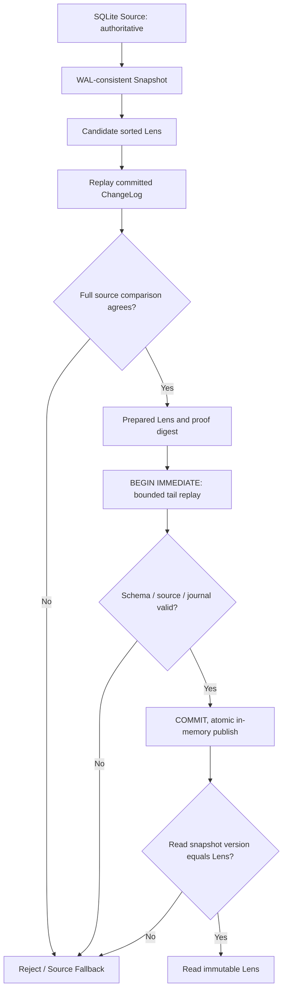

# ADR-003 — OpDB Core Architecture

**Project:** OpDB Foundry / TASK-002 CORE  
**Date:** 2026-11-08  
**State:** Proposed / implemented as a local experimental Python 0.1 prototype; **NOT accepted as production architecture**.  
**Cross-project contract:** ADR-001 principles reconstructed from the OpDB discussion and research reports. The *exact signed text of ADR-001 was not located*, so this ADR must be reconciled with it before acceptance.

## Decision

Develop **OpDB Verified Lens 0.1** as a *disposable, non-production* layer over SQLite WAL (`synchronous=FULL`), with an intentionally minimal `str -> bytes` KV API. SQLite owns transactions, durable commit, isolation, file integrity and crash recovery. Lens is an immutable, rebuildable sorted-key representation for `get()` and bounded `scan()`. The correctness of SQLite and the external storage subsystem is not re-proven by this prototype.

There is **no full SQL implementation**, predictive control, autonomous choice of index, synthetic durability claim, or production deployment. The prototype has no independent physical storage engine.

## Why this decision

- R12 revealed a mismatch in a SQLite/Python lab with schema changes and cached prepared statements; in this code `cached_statements=0` and schema-version checks are used, *not* a claim that a SQLite engine defect was proven.
- R13 found that logging only inside an application wrapper leaves external SQL writes invisible to Lens.
- R14 demonstrated transactional AFTER triggers, a trustworthy SQLite snapshot and a separate verification step. Its final research matrix found online Lens building costly on tested workloads (full covering SQLite index generally won). Consequently **automatic activation remains disabled**.
- R15 lab warned that an epoch check alone does not independently prove untampered Lens content. This implementation fully compares a candidate with SQLite on a single snapshot before publication. A small tail is then replayed on trust in transactionally enforced triggers.

### Language selection

| Criterion | Python 3.11+ (0.1) | Rust (next native core candidate) | C++ (alternative) |
|---|---|---|---|
| Development / experiment cost | Lowest: `sqlite3`, `unittest`, `threading` in stdlib | More code/toolchain, good type discipline | Familiar mature ecosystems but more manual safety work |
| Memory safety | Managed; bugs in native SQLite remain possible | Strong ownership/borrowing guarantees for safe Rust code | RAII and sanitizers help; memory safety not generally compile-time guaranteed |
| Expected native performance | Not suitable as future hot path | Suitable for native engine, predictable memory | Suitable for native engine, mature low-level integrations |
| Testing | Very quick fault injection / deterministic reference states | `cargo test`, property testing / sanitizers | GoogleTest/Catch2, sanitizers |
| Decision | **Use for verified protocol 0.1** | **Prefer for 0.2+ port after proving protocol** | Reconsider if FFI/ecosystem requirements justify it |

`rustc`/`cargo` were not installed in the test container; `g++` was present. The 0.1 goal is semantic safety evidence, not native performance, so Python is a deliberate interim implementation, not the announced final language of OpDB.

## Component contracts and interfaces

1. **TruthStore** (`TruthStore` protocol, `SQLiteTruthStore` implementation): `put(key: str, value: bytes) -> None`, `delete(key: str) -> None`, `get(key: str) -> bytes | None`, `scan(start: str,end: str,limit: int=100) -> list[(str,bytes)]`, `snapshot() -> Snapshot`.
2. **ChangeLog** (`ChangeLog.read`): SQLite triggers append exactly one journal event per INSERT/DELETE and value UPDATE, or two events (delete old key + put new key) for a primary-key rename, in the same transaction, including external ordinary DML. `read()` verifies contiguous integer revision range; `apply()` replays `P` and `D` events. It never accepts an unknown operation.
3. **Lens**: immutable `keys`, `values`, version stamp, SHA-256 content digest and proof/cutover metrics. Uses bisect on ordered keys. `get` and `scan` have same ordering and byte semantics as this restricted source API.
4. **Snapshot**: `BEGIN` read transaction; read metadata revision, schema stamp, rows from a *single* SQLite WAL snapshot. A `source_id` protects accidental cross-file mixing.
5. **VersionManager**: per-process publication of an immutable pointer; retiring a Lens leaves source data unchanged. Previous readers may retain old Lens pointers but must pass the version guard.
6. **Cutover**: before publication, independently scan/compare candidate rows with SQLite on one consistent snapshot; lock SQLite writer via `BEGIN IMMEDIATE`; replay at most `max_events` more committed changes; publish new in-memory pointer after the lock is released. Concurrent new commits after the final version check force source fallback at the next read.
7. **Fallback**: every accelerated read begins its own SQLite transaction, pins its snapshot, checks `source_id`, `schema_version`, `revision` and falls back to SQL **on the same snapshot** if the active version is not identical. A source query failure remains an error, never an invented answer.
8. **Metrics**: build wall/process CPU time, full-proof time, cutover time, estimated Lens Python-object bytes, process peak RSS on Linux, SQLite/WAL file sizes, journal events and read path counters. They are local measurements, not a universal speedup claim.

The API validates Unicode scalar-string keys up to 128 UTF-8 bytes and byte values up to 1 MiB. Source tables enforce BLOB values. Scan bounds are inclusive, binary-sorted, and `limit` is 1..10000. Missing key returns `None`; empty byte value remains `b''`.

## State transitions

`source_id` is a generated UUID saved in SQLite; `schema_version` is SQLite PRAGMA; `revision` is incremented by AFTER triggers inside the same transaction. Full proof is conducted **at the prepared revision**; the last unverified tail is applied using *assumed trustworthy* triggers and contiguous journal. The digest protects against an accidentally changed prepared payload at cutover, but **is not an authenticated proof of correctness for every subsequent read**.

### Commit/read linearization reasoning, restricted to the specified API

- `put/delete`: logical visibility and durability delegated to SQLite COMMIT and its environment; no OpDB transaction acknowledgment is issued before SQLite reports completion.
- `get/scan`: pin one SQLite read snapshot; version read and either Lens access or SQL fallback refer to that snapshot. A write committed after snapshot acquisition may be absent, as permitted by snapshot reads.
- Cutover: pointer changes atomically **within one Python process**, never by in-place mutation. It is not a shared, persistent, cross-process publication protocol.
- Outside this restricted boundary (distributed sessions, arbitrary SQL and DDL, transparent failover, foreign privileges, user-defined collations, multiple OpDB reader processes sharing a Lens), no ACID or formal linearizability proof is asserted.

### Threat and failure model

**Covered in tests:** ordinary direct DML through external connections and a subprocess; rollback; multi-row transaction atomicity; post-snapshot writes; corrupt candidate; bad digest; missing log event; changed schema; process exit before/after SQLite COMMIT; cutover exception before/after COMMIT; missing/deleted keys; concurrent atomic two-key scan; explicit memory/event budget rejection; reopen with no published Lens.

**Excluded or unproven:** actors permitted to modify `opdb_meta`, `opdb_changes` or triggers; forged/reverted schema_version; malicious modification of persisted schema; SQLite extension writes or file-level changes bypassing trigger semantics; physical storage corruption/power cut; isolated crash-test independence across processes; resource exhaustion beyond estimated Lens bytes; file-system failures and process-wide out-of-memory; CPU budgets/deadlines guaranteed under hostile scheduling; transactional schema migrations; multi-process Lens interoperation.

**Operational constraints:** do not copy this layer onto an existing production DB. The constructor refuses an unmanaged database containing ordinary user tables. The change journal currently has no garbage collection and can grow without bound. Large WAL reader pins may delay checkpoint. `BEGIN IMMEDIATE` may block other writers. The Python prototype keeps one copy of candidate and prepared data concurrently; the `size_bytes_estimate` excludes copies and runtime overhead.

## Safety invariants to be preserved in Rust port

- **S1**: all confirmed state lives in Source; never acknowledge a Lens update as a transaction commit.
- **S2**: every supported DML modification atomically advances revision and appends its event, even across external SQLite writers.
- **S3**: snapshot rows, schema and revision share one SQLite read transaction.
- **S4**: no publication without a full semantic comparison at a fixed revision and a complete tail from that revision to cutover.
- **S5**: Lens data is immutable to concurrent readers; new versions are published by one atomic pointer change.
- **S6**: absent/stale/uncertain Lens -> SQL Source fallback on the *same* read snapshot.
- **S7**: optimization failure must not alter Source commit semantics; source failures must be surfaced, not hidden.
- **S8**: budgets or performance regressions may disable Lens; never reinterpret or relax S1–S7.

## Non-goals / release gate

No SQL optimizer, parser, replication, MVCC beyond SQLite, own WAL, automated index selection, cost-based policy, crash-safe journal GC, network API or production-grade disk layout. No branch merge or deployment was performed.

To propose production use, first require ADR-001 text reconciliation; Safety team approval; independent transaction-history checker; instrumented crash/power-loss harness; multi-process/DDL/privilege coverage; independent Rust port; bounded tail cutover and WAL size policies; memory/RSS/CPU/I/O workload measurements including complete maintenance costs. **The current gate is NOT PASSED.**